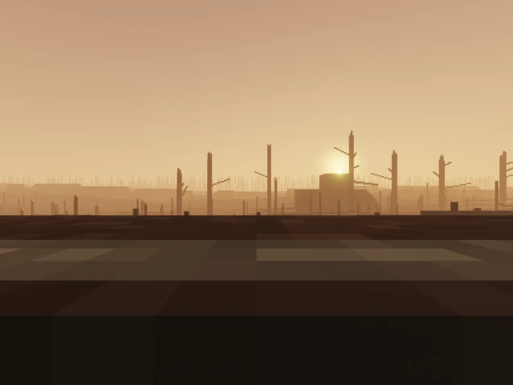

# TRENCHLINE



A front-line trench at dusk, ten centimetres to the voxel, ray traced live in your browser.

You hold a fire bay on the shoulder of a dry ravine. Across fifty metres of shelled ground is another line exactly like yours. Dusk falls into night:
- flares climb from both lines and drift on the wind;
- machine-gun tracers arc over no man's land;
- barrages flicker on the horizon and rumble seconds later;
- shells set the ruins burning, and the craters' water holds it all.

Every wall, sandbag and duckboard is made of 10 cm voxels. A shell cuts into the ground you were counting on, and you dig yourself back out.

You carry a long gun and a pistol. Every round is a tracer; a hit is marked, heard and bled, and a kill rings.

## Play

Play it at [lordjord78.github.io/Voxel-Trench-Warfare](https://lordjord78.github.io/Voxel-Trench-Warfare/), in a desktop browser with WebGPU: Chrome or Edge 113 or later, or Safari 26. Where WebGPU is missing, the page shows a video of the game instead. Click to play; the mouse looks around.

There are two maps, and the start screen's **Map** picker chooses one (each is its own world, generated afresh):
- **Sukhyi Yar:** two systems of trenches across a field, with the dry ravine between them;
- **The Corridor:** a wood down the middle of the map, with one side dug in at each end of it.

**Play solo** puts you on a range in front of your fire bay:
- dummies stand at 25 to 150 m, and two walk back and forth at 50 and 90 m;
- steel plates ring at 30 to 85 m, with head-sized ones at 45 and 70 m;
- each hit reads out where it struck, how hard and from how far, and a kill how many shots it took;
- the battle goes on around you.

**Loadout**, on the start screen, in the lobby and in the pause menu, picks your guns:
- the long gun: a 5.45 assault rifle, a 5.56 carbine, a 9 mm submachine gun, a 7.62 marksman rifle, a 5.56 light machine gun or a 12 gauge shotgun;
- the pistol: a 9 mm or a 9x18;
- each gun's fit: an optic (iron sights, a red dot, a holographic sight or a scope), a muzzle (a suppressor or a compensator), a grip, and a light or a laser.

You choose before you go in, and again while you wait to come back after a death.

## Play with friends

Up to eight players, Red against Blue:
1. **Host.** One of you clicks **Host a game with friends** on the start screen. Your lobby opens with the game's five-letter code in its title and its link beside **Copy link**.
2. **Join.** Send your friends the link (Discord works well), or tell them the code: they type it in the box next to **Join** on their start screen. A code never has an I or an O. A friend's page builds the world first, then their lobby opens.
3. **The host's settings.** Everyone names themselves and picks Red or Blue. The host sets the match:
   - the map, Sukhyi Yar or The Corridor (everyone's page goes to it and builds its world, and everyone comes back on their side, the host still the host);
   - the kills to win;
   - the time of day;
   - the battle: quiet, light fire or heavy fire.
4. **Ready.** Everyone but the host clicks **Ready**; the host sees who is ready, and clicks **Start the match** whenever they like.
5. **The countdown.** Three seconds, while each page puts you at your side's start.
6. **Go.** Click **Go** to go in. Each side wears its colour on the arm and the helmet; friendly fire is on, and a team kill costs your side a point. The first side to the kill target wins, and everyone goes back to the lobby for the next match.

The battle is everyone's:
- every shell lands at the same moment and place for everyone, and cuts the same crater;
- the enemy line fires on both sides, in amber;
- what one player digs, everyone sees dug;
- a friend who joins mid-match, or reloads, catches up on the battle so far before they deploy. A reload within two minutes puts them back on their side, with their kills and deaths.

The rooms run on a small Cloudflare Worker ([server/](server/)). Everyone needs a desktop browser with WebGPU, and the same version of the page: the start screen says so if a game is on another one, and a reload fixes it. A game nobody has played in for 20 minutes is closed, so a tab left open does not keep it running.

## Controls

| Keys | |
|---|---|
| <kbd>W</kbd> <kbd>A</kbd> <kbd>S</kbd> <kbd>D</kbd> | Move |
| <kbd>Shift</kbd> | Sprint |
| <kbd>Space</kbd> | Jump; stand up from crouching or lying down |
| <kbd>C</kbd> / <kbd>Z</kbd> | Crouch / go prone |
| <kbd>W</kbd> into the bench | Climb onto the firing step |
| <kbd>W</kbd> + <kbd>Space</kbd> at a wall | Climb over it: out of the trench, over the parapet or the parados |
| <kbd>Q</kbd> | Periscope, on a firing step |
| Left mouse | Fire |
| Right mouse, held | Aim down the sights |
| <kbd>R</kbd> | Reload |
| <kbd>1</kbd> / <kbd>2</kbd>, or the wheel | The long gun / the pistol |
| <kbd>B</kbd> | Single shots or automatic, on a gun that has both |
| <kbd>L</kbd> | The gun's light or laser, on and off |
| <kbd>F</kbd>, held | Out with the shovel: dig out loose earth |
| <kbd>M</kbd>, held | The trench map |
| <kbd>Tab</kbd>, held | The score, in a match with friends |
| <kbd>H</kbd> | The keys, on screen |
| <kbd>Esc</kbd> | Pause: the loadout, quality, mouse sensitivity, field of view, the time of day and how fast it passes, incoming fire |
| <kbd>Alt</kbd> + <kbd>Enter</kbd> (<kbd>Option</kbd> + <kbd>Return</kbd> on a Mac) | Fullscreen and back, as the Fullscreen buttons on the start screen, in the lobby and in the pause menu do. In Chrome and Edge, Esc still pauses when fullscreen; hold it down to leave fullscreen |
| <kbd>F3</kbd> | Frame timings |

## How it is made

TypeScript and raw WebGPU, with no engine:
- **The worlds:** two maps, each 256 × 256 m and 32 m deep, of 10 cm voxels, generated in the browser by workers. They hold trenches, dugouts, a hamlet and woods, and distant terrain beyond to the horizon.
- **Rendering:** a voxel ray tracer over a brick map. Its main features:
  - many shadow-casting lights, with reuse between pixels and frames;
  - a froxel haze with light shafts and smoke;
  - a physically based sky with the moon and stars, and a full day-to-night cycle;
  - denoising, temporal anti-aliasing, bloom, automatic exposure and film grain.
- **Destruction at 10 cm:** shells carve craters, soil slumps, and the player digs it out.
- **Combat:** eight guns and their attachments, drawn in the hands, with ballistics, recoil, suppression and the effects of fire. Every round is a tracer in its side's colour, and hits have their own marks, sounds and blood.
- **Playing together:** a relay on a Cloudflare Worker runs each room's match and its shelling. Every client cuts the same craters from the shells' seeds, and a late joiner replays the room's log.
- **The battle around the player:** a deterministic director fires flares, barrages, tracers and fires, and the water reflects them.
- **Quality:** two quality presets and dynamic resolution hold a 14 ms GPU budget at 1.5 megapixels; a first visit whose machine cannot hold the high preset is moved to the low one.

## How it is tested

- **Unit tests (Vitest):** generation, physics, ballistics, destruction, the battle, sound planning and the renderer's arithmetic.
- **GPU tests (Playwright in Chrome):**
  - shaders against references;
  - the game played through its test hooks;
  - captures for review.
- **Performance gates:** every standard view, at dusk and at night, holds its GPU time within 14 ms at the 95th percentile on an M1 Pro in Chrome, on mains power. That includes the battle at its peak, with the player firing on full auto under shellfire, where the overview at night sits at the budget's edge (13.4–13.6 ms).
- **Safari:** the same check runs in Safari (`npm run safari`) and reports.

## Run it

With Node 22.12 or later:

```sh
npm install
npm run dev          # the dev server
npm test             # unit tests
npx playwright test  # GPU tests, in Chrome with WebGPU
npm run build        # the static site, in dist/
```

The build works from any path. [The Pages workflow](.github/workflows/pages.yml) tests it, builds it and publishes it to GitHub Pages on a push to `main`.

## Design

The design is in eight specs, from [the world](docs/superpowers/specs/2026-10-21-trenchline-web-world-design.md) to [the showcase](docs/superpowers/specs/2026-10-25-trenchline-web-showcase-design.md), [playing it together](docs/superpowers/specs/2026-10-30-trenchline-multiplayer-design.md), [the shots](docs/superpowers/specs/2026-11-03-trenchline-shots-design.md) and [the shared battle](docs/superpowers/specs/2026-11-04-trenchline-shared-battle-design.md). The build plans are in [docs/superpowers/plans/](docs/superpowers/plans/).

## Python reference

The original Python/Ursina game lives in [reference/python/](reference/python/). It stays runnable, and its tests stay green, until the web version has ported everything it does. The web game's movement has since gone its own way (climbing out of any trench, the firing step only on the bench, no getting stuck); the parity tests still replay Python's recorded scenarios, on Python's own numbers, with those additions off. Run it from that folder with the repo's virtual environment:

```sh
cd reference/python
../../.venv/bin/python -m trenchline      # play
../../.venv/bin/python -m pytest          # 283 tests
```
